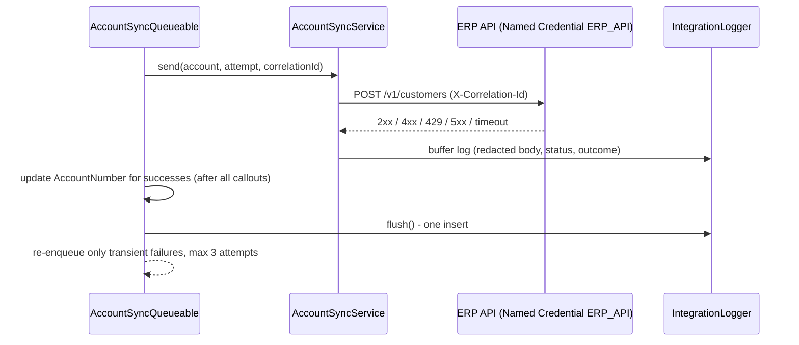

# Resilient REST Integration (Queueable callouts, retries, structured logging)


## Business problem

Point-to-point Salesforce integrations often fail silently. A timeout or 503 drops the update, nobody can tell which record failed or why, and support teams end up reading debug logs. This project shows an outbound integration that retries transient failures, never retries permanent ones, and leaves a searchable log record for every call, with sensitive values redacted.

## Tech stack

Apex (Queueable + Database.AllowsCallouts), Named Credentials, custom object logging, HttpCalloutMock, Salesforce DX, GitHub Actions

## Architecture



## What it demonstrates

- Retry policy: 429, 5xx and callout timeouts are retried by chaining a new Queueable, up to 3 attempts. 4xx and unparseable responses fail immediately.
- Callouts first, DML after. Logs are buffered and written once, which avoids the "uncommitted work pending" error.
- Respects the callout governor limit. Records over the per-transaction limit move to the next job.
- One correlation ID per sync run, sent as a header and stored on every log, so a run can be traced across systems.
- `IntegrationLogger.redact()` masks `password`, `token`, `ssn`, `authorization` and similar keys before anything is stored.
- `Integration Log Viewer` permission set gives support teams read-only access.

## Project layout

| Path | Purpose |
| --- | --- |
| `classes/AccountSyncQueueable.cls` | Async orchestration and retry |
| `classes/AccountSyncService.cls` | Request building, response classification |
| `classes/IntegrationLogger.cls` | Buffered, redacted logging |
| `classes/ErpCalloutMock.cls` | Scriptable mock (status sequence) |
| `objects/Integration_Log__c` | Log object and fields |
| `permissionsets/Integration_Log_Viewer` | Read-only access for support |

## Run it yourself

Prerequisites: [Salesforce CLI](https://developer.salesforce.com/tools/salesforcecli), a Dev Hub org (a free Developer Edition org with Dev Hub enabled works), Node.js 20+.

```bash
sf org login web --set-default-dev-hub --alias devhub
sf org create scratch --definition-file config/project-scratch-def.json --alias demo --set-default --duration-days 7
sf project deploy start
sf apex run test --test-level RunLocalTests --code-coverage --result-format human --wait 20
```

## CI

`.github/workflows/ci.yml` runs on every push and pull request:

1. **Static checks**: Prettier with the Apex parser (this fails on any Apex syntax error).
2. **Apex tests in a scratch org**: runs only if the repository owner adds a `SFDX_AUTH_URL` secret (Settings > Secrets and variables > Actions). Get the value with `sf org display --verbose --target-org devhub` (the "Sfdx Auth Url" line). **Never commit it.**

## Security notes

- No credentials, endpoints, org IDs or tokens are stored in this repository. `.gitignore` blocks common secret files.
- Apex runs `with sharing`, and queries and DML use `USER_MODE` so object-, field- and record-level security is enforced; the logger alone writes in system mode so failures are always recorded.

## Limitations and next steps

- The Named Credential `ERP_API` is not included. Create one (with an External Credential) that points to any test endpoint, for example a mock server you control.
- Retries re-enqueue immediately. A production version would add backoff with a scheduled retry or use Platform Events.
- Chaining is disabled under test because Salesforce does not allow chained Queueables in tests. Tests assert the retry decision through the log outcome.

## About this project

This is an independent portfolio project. It demonstrates patterns I have used on enterprise Salesforce engagements, rebuilt from scratch on the standard data model with synthetic data. It contains no client or employer code, data, object names or configuration. It was developed with AI-assisted tooling and reviewed by me.

## License

MIT. See [LICENSE](LICENSE).

